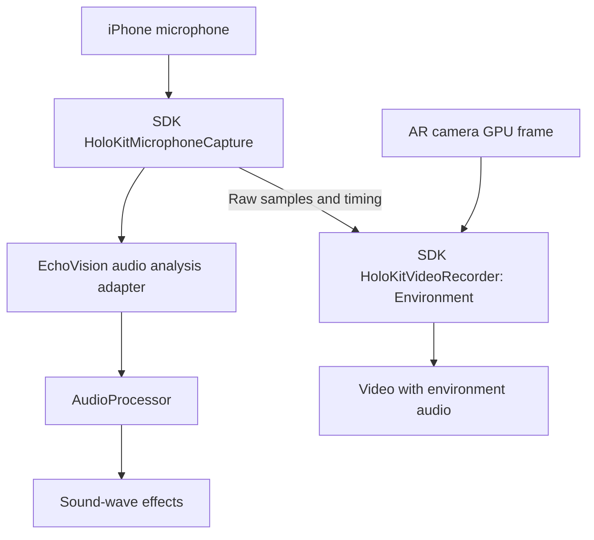
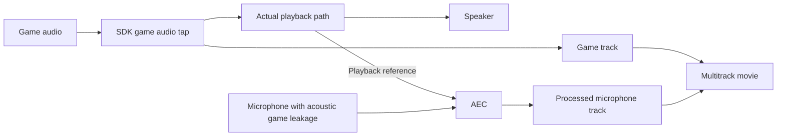

# Recorder audio configuration — accepted design and implementation status

Scope: design subsequently authorized for implementation and testing by Amber. Both downstream SDK repositories remain untouched until EchoVision passes its acceptance gate.

## Accepted product scenarios (user clarification)

The public SDK should expose two clear presets, not every independent routing combination as end-user settings:

| Preset | Live game playback | Microphone processing | Recording |
|---|---|---|---|
| EchoVision / Environment | No game speaker output | Raw environment audio; AEC and voice-oriented noise suppression off | Environment audio track; raw mic also feeds sound analysis |
| MOFA / GameWithCleanMicrophone | Game plays through speaker or headphones | AEC using the actual playback reference, removing game-speaker leakage as far as possible | Separate internal game track and AEC-processed microphone track; optional mixed sharing export |

For MOFA, accept the user's final explicit example as authoritative: record both game and external microphone separately, with AEC on the microphone. Do not interpret the earlier ambiguous sentence as a request to omit microphone recording.

AEC integration is a validation prerequisite, not an implemented switch. Evaluate the actual Unity playback/native capture path, reference timing, residual echo, game output quality, latency and route changes. Avoid enabling voice noise suppression/automatic gain indiscriminately; those can damage non-speech environmental signals. AEC cannot guarantee complete acoustic separation.

The lower-level dimensions below describe internal responsibilities and conflict handling; they are not a proposal to add a large end-user settings panel.

## Current evidence

- EchoVision Main Camera contains both HoloKitVideoRecorder and AudioListener. OnAudioFilterRead therefore taps listener audio; the microphone source reference is a playback/lifecycle dependency, not a dedicated microphone PCM input.
- MicrophoneAPI shares a looping microphone AudioClip between analysis and recording sources. Analysis group is -80 dB; recording routes to Master, volume 0.5 at runtime.
- StartRecording requires microphone source/clip and plays that source. OnAudioFilterRead writes one native AAC input then unconditionally clears the listener buffer, including outside recording. The current API cannot independently configure game capture, mic capture, playback, or monitoring.
- Native writer has one audio input. Mono/stereo channel layout is not separate game/mic tracks.

## Independent configuration dimensions

| Dimension | Choices / semantics |
|---|---|
| Capture sources | None, Game, Microphone, GameAndMicrophone. Game means this application's Unity audio, not arbitrary system/other-app audio. |
| Track layout | Mixed; SeparateSources; MixedAndSeparateSources. Normalize one-source layouts to one track; None has no audio inputs. |
| Capture levels | Independent game and mic gain/mute, separate from playback volume. |
| Playback | Normal game playback independent of recording; microphone monitoring off by default. |
| Analysis | Microphone use for AR/audio triggers is independent of microphone inclusion in a movie. |
| Missing source policy | Explicit fail-required-source or allow-degraded-source; report actual sources and reason. Never silently change a requested recording. |
| Output format | Stable file sample rate/channel layout; preserve game stereo and mic mono as appropriate. Resolve supported format at start. |

Freeze source/track topology at recording start. Gains and mute may change during recording; selected tracks remain present, and muted intervals retain timeline continuity. Adding/removing/reformatting tracks starts a new recording segment.

## States

Idle -> Preparing (permissions, route, source availability, output format, writer inputs) -> Recording -> Draining (no new input; finish outstanding GPU and audio work) -> Finalizing (writer completes) -> Idle.

Failure reports a reason and releases resources before another start. Microphone mute/unavailability is a source status, not another global recorder lifecycle. Initial background/sleep policy: finish the current segment. Seamless pause/resume with timestamp rebasing is a separate feature.

## Routing and conflicts

1. Keep game and mic PCM separate before mixing. Capturing the listener mix and also adding mic duplicates mic; separating an already mixed signal is not a reliable capture design.
2. Split capture from playback. Do not globally clear the listener to prevent mic feedback. A source-level mic tap with a silenced monitoring branch is a candidate; Unity virtualization/filter ordering and route behavior need device tests before selecting it. AudioMixerGroup cannot simply be assigned to OnAudioFilterRead as a capture API.
3. One owner manages microphone permission, lifetime and audio session. Recording and analysis request the same source without stopping each other. Game-only capture must not require mic permission, even if EchoVision's independent analysis feature does.
4. Independent capture gain avoids changing what the player hears. Retain separate source tracks before mix-specific limiting. Leave mix headroom; do not write unclamped sums that clip.
5. Speaker sound can acoustically enter mic even when software routes are isolated. Headphones avoid much of this; optional echo cancellation changes the signal and may conflict with environment-sound analysis. Do not promise perfectly isolated acoustic mic tracks. Turning off microphone monitoring only prevents mic playback; it does not remove game-speaker leakage. If AEC is introduced, explicitly select raw or processed mic for analysis, independent of recorded mic processing.
6. Normalize all samples to a shared recording timeline. Account for microphone buffering and differing capture latency; test drift over long recordings, not only matching file durations.
7. Route changes (Bluetooth, wired headphones, interruptions) can change rate/channels/latency. Convert to the fixed output format, or finalize the segment with a reason if unsupported. Do not append a new PCM format to an existing fixed-format input.
8. Use bounded audio queues, report overrun/backpressure and gaps, and drain asynchronously at stop. Current native audio return -3 is temporary backpressure and is not surfaced as a dedicated dropped-audio metric.
9. More tracks mean more AAC encoders/buffers and storage; measure on device. GPU video capture remains unchanged. PCM gain/mixing does not justify a new GPU pipeline.

## Multitrack output

AVAssetWriter supports concurrent tracks in MOV/MP4. Proposed advanced output: final mix (default playback), game stereo stem, microphone mono stem. Validate enabled/default flags, track labels and actual import/playback behavior. Do not group simultaneous stems as AVAssetWriterInputGroup alternatives: that API represents mutually exclusive tracks, such as alternative languages.

Ordinary sharing should produce a file with one final mix track. A multitrack file is an editing asset; do not assume Photos/social apps preserve all tracks or mix them automatically. Optional export/remux can create the sharing version without changing the real-time video capture path. Test this instead of promising universal compatibility.

## Acceptance matrix

- Every source selection and meaningful layout; mic permission denied, source unavailable, and app audio absent.
- Known distinct test tones per source: prove game-only excludes mic, mic-only excludes game, mixed contains both, stems remain isolated, and gain/mute affect only intended outputs.
- Game playback remains audible when required; microphone monitor is off; analysis continues when mic recording is disabled.
- Verify track count, names, default/enabled behavior, sample rate/channels, timestamps and full decode. Test target editors and ordinary sharing separately.
- Long recording plus a common audiovisual event for onset offset and drift; Bluetooth/headphone changes and interruptions.
- Start/stop/restart, no frames, mute intervals, backpressure, disable/destroy, sleep and OS background/resume; no main-thread GPU/audio drain waits.
- Compare device CPU, memory, temperature and stop latency for one versus multiple audio tracks.

Suggested staging: preserve and validate EchoVision Environment first; prototype and validate MOFA playback reference plus AEC, then separate game/mic tracks and sharing export. No downstream promotion until applicable acceptance criteria are met.

Primary references:
- https://developer.apple.com/documentation/avfoundation/avassetwriter
- https://developer.apple.com/documentation/avfoundation/avassetwriterinputgroup
- https://docs.unity.com/en-us/engine/6000.3/manual/audio/reference/filters/class-audio-effect

AEC source check: Apple explicitly states that merely selecting a voice/video/game chat AVAudioSession mode does not apply echo cancellation without Voice Processing I/O or AVAudioEngine voice processing. Voice-chat mode also changes tonal equalization and allowed routes; validate game audio quality and Bluetooth behavior rather than treating it as a harmless flag.
- https://developer.apple.com/documentation/avfaudio/avaudiosession/mode-swift.struct/voicechat
- https://developer.apple.com/videos/play/wwdc2019/510/

## Inspector and ownership (user request)

Proposed SDK components, not yet implemented:
- HoloKitVideoRecorder: AudioMode, MicrophoneInput reference, optional GameAudioListener reference, output layout and independent capture gains. Scene-specific application classes must not appear in this API.
- HoloKitMicrophoneCapture: one microphone owner, sharing the input with capture/analysis consumers. No separate microphone AudioListener; do not add a second Unity listener.
- SDK listener tap: attaches at the selected game AudioListener. Specifying a listener alone is not sufficient to implement AEC; actual playback reference/timing must also be validated.
- EchoVision analysis adapter: consumes SDK microphone data for AudioProcessor and sound-wave effects. Stopping recording releases only the recorder's use; analysis can keep microphone capture active.

Environment preset hides/disables game listener and AEC controls; records raw mic without routing it through the game output. GameAndMicrophone preset selects Main Camera listener, mic input, separate tracks, and AEC. Recording configuration must not globally mute normal game playback.

## Implementation checkpoint (2026-09-22)

Integrated in the working tree, not yet accepted on device:
- SDK shared native microphone owner; EchoVision MicrophoneAPI is now a scene/ownership adapter and AudioProcessor reads its raw samples/spectrum directly. No microphone AudioSource playback or global listener-buffer clearing.
- Recorder Inspector has Environment / GameAndMicrophone modes, shared microphone input, game listener, optional microphone inclusion for game-only capture, and independent capture gains. Game and microphone use actual separate AAC tracks. Mixed sharing export is still outstanding.
- Video and microphone use the native monotonic host clock. Game DSP time is anchored to the same clock at recording start. This clock mapping still requires flash/pulse measurement on real hardware.
- Audio callbacks enqueue bounded PCM without invoking AVAssetWriter; a serial worker encodes, clips to a common start/stop window and drains asynchronously. A 150 ms timestamped tail permits stop clipping and late input delivery. Capture gains are stored with each packet. Overflow/format errors are reported, not silently rebased.
- Host AVAssetWriter tests: six existing cases plus source masks none/game/mic/both passed. The dual-source fixture uses stereo 48 kHz game and mono 44.1 kHz mic, deliberately starts callbacks at 60/160 ms, and inserts pulses with a 70 ms inter-source offset. File starts retain those offsets; decoded onset errors <=3.11 ms. This proves writer timeline behavior, not physical input/video synchronization, drift over long capture, or AEC.
- Unity EditMode 39/39 passed after integration; physical iOS build and testing in progress.

Open: actual environment capture/analysis and lifecycle validation, stereo-game tap validation, AEC speaker measurement, flash/pulse start offset and long drift, optional mixed sharing output, interruptions/routes/permissions, and full final-build regression.

### Integrated device evidence and outstanding failure

- First integration run failed all starts because Unity's microphone authorization check reported denied. The native AVAudioApplication check reports granted. Replaced the Unity permission path with native asynchronous authorization; the actual microphone then delivered timestamped PCM.
- `native-permission-background`: two movies passed, including valid unchanged file before resume; microphone samples are nonzero, no audio queue loss.
- `native-permission-stop`: 91 scenarios / 90 movies passed, zero device/collector errors and zero retained inputs/textures. Footprint 831–1057 MiB, ending 910 MiB.
- Startup order initially prevented EchoVision's analysis lease from acquiring. Added an early execution order to the SDK microphone. The subsequent fixture log shows native microphone capture starts at scene launch, before the test releases analysis at six seconds. Still verify analysis effects and off-record behavior explicitly.
- `device-audio-fixture`: environment, game-only and game-plus-AEC took real device recordings with zero audio loss. Game-only flash/pulse offsets -6.7 to +30 ms (median +10 ms); AEC scenario's game track -16.7 to +18.3 ms (median -15 ms). This is short-run game timing only.
- AEC **not accepted**: environment-mode speaker leakage was too weak to serve as the baseline, while voice-processing input had different gain. Added an exported-test-only voice-processing bypass control and hold the same shared AEC input across bypass/AEC takes. This isolates processing from route/gain changes. That comparison is now being built. No near-end voice preservation or long drift result yet.
- Track labels are present in MP4 `udta/titl` atoms although ffprobe does not expose them as tags. Target editor/AVFoundation metadata validation remains open.

### AEC matched-path reanalysis

`device-aec-bypass` completed four real-device takes: Environment, GameOnly, Game+Microphone with voice processing bypassed, then enabled. One shared AEC input remained alive across the final pair, and bypass state changes were verified by the native test ABI.

The initial analysis window was wrong: it looked within -40/+140 ms of the visual flash, while microphone speaker leakage peaked ~275 ms after the game track. That caused an invalid 0.82 dB estimate. Preserve it as `audio-measurements-before-lag-check.json`, not as an AEC implementation failure. Band-envelope correlation over the original timelines finds correlation 0.971 at +275 ms in the bypass take. Using that same fixed acoustic path delay only to select the speaker-stimulus measurement windows, the enabled take shows 37.33 dB lower speaker energy. No file timestamp was shifted. This is real speaker attenuation evidence, not yet full AEC acceptance: verify near-end voice preservation and timing separately.

Do not assume Unity playback is absent from Apple's echo reference or add another playback route based on the invalid initial metric. First inspect Unity DSP buffers and AVAudioSession/input/output presentation latency. The 275 ms round trip combines playback and capture/processing delays; subtracting all of it from microphone timestamps would be unjustified. The latest source logs those latencies for the next test build.

### Latency instrumentation follow-up

The `device-audio-latency` build reports Unity 24 kHz, 1024 frames × 4 DSP buffers (~171 ms queued capacity), session IO duration 42.67 ms, input presentation 1.375 ms and output presentation ~9–10 ms. This makes Unity/output buffering a concrete candidate for much of the measured 275 ms acoustic loop delay; do not arbitrarily offset microphone PTS.

Environment input startup failed in that diagnostic build. A likely observer effect is: reading `engine.outputNode` solely to log its latency creates an output node on an otherwise input-only engine. Removed that graph-changing diagnostic access for Environment; use AVAudioSession outputLatency there. Voice-processing mode already owns both nodes. The correction still needs a rerun; that diagnostic run is a failed run, not acceptance evidence.

Added `audio-low-latency` as a test-only fixture variant which requests a 256-frame Unity DSP buffer before starting sources; it will distinguish queued playback latency from input timestamps. Production audio settings are unchanged. Latest Unity export for this variant is in progress; no result yet.

All native host cases still pass after writer failure-drain guards and atomic final error status. `audio-checkpoint-editmode.xml` has 39/39 passes. Current tests stamp a run ID into mode files/reports to reject stale artifacts. Rebuild required before using the updated runner with older installed players.

## Physical fixture and long-run checkpoint, 12:19

- RecorderStopProbe and its support assemblies/CLI now live in the embedded SDK's `Tests/Recorder`; EchoVision keeps only its scene/sleep adapter. The standalone SDK repository is still untouched pending validation.
- Initial gains are passed into native Start before recording input is published. Host regression confirms initial mute and gain changes at packet capture time.
- Optional mixed sharing output is implemented asynchronously, preserving the separate-track master. Host tests verify one mixed AAC track, exact compressed-video hash equality, expected gains, missing-source failure, preservation of an existing destination, cancellation cleanup, and recovery after failure. Physical mixed-output validation remains open.
- The two 610-second game/AEC takes completed on iPhone 15 Pro/iOS 27 with zero device assertions/audio queue failures. Original movies were fully decoded. The timing analyzer FAILED: game-only worst offset -63.3 ms and its first/last-five-event drift 23.3 ms; the short bypass take's drift statistic also exceeded 20 ms. AEC attenuation 38.50 dB, correlated speaker delay 280 ms. Preserve `device-audio-long/audio-measurements.json`; do not relabel this run as passed. All-event trend estimates suggest quantization/jitter affects the five-event statistic; this is diagnostic, not replacement acceptance evidence.
- User placed the phone facing the **lower built-in-display Chrome window**, a separate one-tab window. The upper many-tab Chrome window is the wrong target. The initial `device-external` take is invalid due to wrong-display stimulus. Stop/reload that upper page and leave it inactive.
- `device-external-lower` captured the correct physical screen and microphone, no Unity flash overlay. Screen ROI .25,.05,.4,.3 in the recorded image has strong contrast (252). Median microphone minus camera onset is about -160 ms, failing the 50 ms gate. Several 60 ms flashes are missing and conversation produces false tone edges. Preserve original evidence. The next fixture extends pulses to 150 ms, rejects non-tonal audio, and records ARCameraFrameEventArgs timestamps/exposure at each offscreen recording render. No production timing shift has been introduced.
- Browser stimulus uses `AudioContext.getOutputTimestamp` to estimate speaker presentation; it does not provide photodiode-calibrated display timing. Its software timing uncertainty must remain explicit.

## Evening device allocation and fixture visibility, 22:07

- User explicitly switched this work to **iPhone 16 Pro, UDID 00008140-001111563A0B001C**. Leave iPhone 15 Pro to the concurrent HoloWeb job. That job repeatedly launched its app on 15 Pro, backgrounding and invalidating EchoVision's `device-camera-age` take after about 8 s.
- SDK current EditMode regression rerun: **39/39 passed**, `sdk-regression-current.xml`.
- `device-camera-age-16pro` completed recording with no device assertion failures. Frame-end diagnostic measured AR camera timestamp age: min 38.22 ms, median 42.51 ms, p95 48.59 ms, max 213.38 ms; exposure median 16.39 ms. This alone does not explain the previous physical 100–160 ms discrepancy.
- Both phones' extracted camera frames show the HoloWeb QR page on the built-in display, although native UI automation sees the separate Chrome fixture window. Chrome's Window menu confirms the fixture window is on the built-in display (offers Move to DELL P2423DE). Raising it did not establish physical visibility; a coordinate click failed with `windowNotFoundAtPosition`. User has been asked to make the lower-screen fixture visible. No synchronization acceptance claim is possible for these runs.
- Added partial-report persistence to the SDK audio probe when an app interrupts it; the installed `camera-age` binary precedes that reporting-only update. No production clock offset was added.

## iPhone 16 Pro mixed-output regression, 22:08

`device-mixed-16pro`: all four device takes completed with no device assertions or audio queue loss. Full decode/topology/flash-pulse analyzer reported no errors. The optional AEC/game sharing file has one AAC track, and its compressed video hash exactly matches the separate-track master (`2ace80dfb024f628d70c1aaa5c755aecce4ac7484329d8a682bcd0e40ee2bf0f`). Native writer and mixed-export input weak-reference counters are zero after finalization.

AEC tone attenuation was 10.10 dB on this take (bypass correlation .9942, acoustic speaker path 250 ms), much lower than the earlier 15 Pro measurements. This crosses the fixture's 10 dB floor, but should not be presented as robust cross-device AEC quality acceptance; independent near-end speech and a quiet repeat on 16 Pro remain relevant. Concurrent HoloWeb testing continues on 15 Pro; its possible acoustic effect was not measured. Physical camera/microphone sync remains unaccepted because the camera faces the QR page rather than the fixture. A fresh 91-case stop-pressure run is in progress on 16 Pro.

## Safari physical-screen correction and iPhone 16 Pro results, 22:20

The user identified the actual lower display as Safari, then explicitly authorized testing in Safari. Opened the fixture in a new tab in the existing Safari window, preserving the HoloWeb marker tab. The `device-safari-16pro` extracted dark/bright camera frames now prove that the fixture is visible to the phone. This supersedes the earlier mistaken assumption that raising the Chrome window established physical visibility.

The first Safari take is NOT a sync pass: screen-only ROI (.05,.05,.4,.75) has contrast 247, but no sufficiently strong 1200 Hz microphone events were found. Audio RMS is 0.0000608; no offset can be computed. Browser report also shows a 569 ms maximum animation gap, and some flashes are missed. Investigate the fixture/acoustic path before changing production timestamps. Device recorder lifecycle assertions passed.

Current 16 Pro stop regression completed all 91 device cases, with all 90 nonempty movies decoded and no validation errors. Async Stop call median is 0.031 ms non-4K and 0.034 ms 4K, versus synchronous-test baseline about 22.7/22.9 ms. Background regression validated both movies and pre-resume finalization. DeviceStateWalk completed with zero assertions and five decodable movies; requested upside-down portrait resolves to portrait on this phone, so actual upside-down coverage remains unproven. Three audio-trigger emissions were logged while recording; idle-trigger and visual reaction acceptance are not established by those logs.

The 16 Pro report identifies the installed OS as iOS 26.0. Building with Xcode/iOS 27 SDK does not establish an iOS 27 runtime pass on this device.

Safari repeat captured 22 regularly spaced flashes. The standard analyzer still fails because its absolute tone floor rejects this very weak input. Independent 440 Hz afplay recording contains the correct frequency but is also quiet (RMS 0.0000809). Post-hoc 20 ms coherent analysis using neighboring-frequency noise finds all 22 Safari 1200 Hz pulses with matching 1.3 s cadence; diagnostic microphone-minus-camera median -0.07916650000000036 seconds. This is diagnostic only, not a replacement pass or justification for a constant timestamp shift. Both original failure reports are retained.

## Timecode and external-fixture lifecycle correction, 22:33

Added large elapsed HH:MM:SS.mmm, pulse number, frame number and per-frame JSON values using the same estimated speaker clock as the flashes. Physical phone footage confirms visibility. Reduced font width after the leftmost digit touched the camera frame edge. The first complete browser log (75ee7c87) contains 5,356 frames and 65 flash onsets but fails monotonicity at startup: Safari initially returned an all-zero output timestamp. Added a validity guard before showing/logging timecode. The subsequent run was interrupted before its full report; it is not a validated complete run.

The user correctly observed that EchoVision was no longer open while the browser continued counting. The old external probe recorded 30 seconds and called Application.Quit(), while the browser fixture lasted 90 seconds. This is a coordination defect in the test procedure, not evidence that simultaneous capture never occurred during those first 30 seconds. Reopened EchoVision on iPhone 16 Pro (PID 5580 at launch); stopped the browser fixture.

Changed only test infrastructure: external capture now lasts 120 seconds, persists a ready report, restores application analysis and remains open after completing. Its runner launches without console attachment, polls fresh run-ID reports, prints EXTERNAL-READY before the operator starts Safari, and collects after completion without killing the app. Added an EchoVision test-profile manual mode to suppress the automatic orientation walker for manual inspection. Unity CLI build and device validation of this lifecycle fix are in progress; do not count the new behavior as passed yet.

## Continuous external run verified, 22:40

Unity CLI and Xcode lifecycle builds succeeded. Installed bundle EEEE7B81-013B-486B-B6CC-9707776B4D3B on iPhone 16 Pro. New runner waited for fresh device run 3311f7a72287409da515c6e9ad234bf6 to report recording ready before Safari run 23f42de1-aead-4347-b53d-46eacdcdd70c started. Browser logged 5,247 display frames, 65 flashes, and zero backward timecode values. The device recorded 120 seconds, 4,691 submitted frames, zero recorder drops and zero assertions. After EXTERNAL-COMPLETE, devicectl process inventory still showed EchoVision PID 5587. This validates the previously broken keep-open test lifecycle.

Physical sync still FAILED: median audio-minus-camera -142.5 ms and first/last-three drift -56.7 ms, plus missed events/cadence failures. A noise-relative coherent tone detector now handles weak raw input; four synthetic tests cover several gains, leading gaps, initial partial pulses, silence/noise and wrong-frequency rejection. The older 30-second Safari repeat under this detector still fails the unchanged 50 ms gate (median -73.3 ms, drift -5 ms), so detector changes do not manufacture a pass.

New diagnostic evidence: camera frame age rises from median 45.9 ms in the first 20 seconds to 102.9 ms at 40-60 seconds and 113.2 ms at 100-120 seconds. The physical offset changes at the same point, from roughly -80 to -140/-150 ms. Video render cadence and camera-age bins are saved in timing-diagnostic.json. Current production video PTS is render host time, whereas camera pixels were captured earlier. Investigate an explicit camera-capture timeline versus rendered-game timeline and mixed-content implications; do not add a guessed constant offset or claim the display fixture is photodiode-calibrated.

## Camera-capture clock experiment and device contention, 22:49

Added audio-external-camera as a test-only experiment. Before the recorder end-of-frame coroutine, the probe changes only its managed video origin to make video PTS follow the latest AR camera timestamp; native microphone origin remains unchanged. Original host origin is now retained in Take metadata. This is deliberately not a production video timing policy. The latest test build succeeded through Unity CLI and Xcode, installed as bundle A354ACAF-B2AA-4AEA-B35C-E5A7CB7F4A9F.

The runner again waited for fresh recording readiness before starting Safari. Browser run ae1dbf23-e58b-41b6-9560-76d32bcb9d34 logged 5,265 frames and 65 onsets with monotonic timecode. The fixture now uses 300 ms pulses at amplitude 0.8 to reduce weak-signal and short-flash losses. Device run 429a80f111804ebf988320d1abfc1821 was interrupted after 84.28 seconds, leaving completed=false. Live process inspection found concurrent devicectl launches of org.realitydeslab.qrealm and com.holoi.holokit.holokit-app targeting the same user-assigned iPhone 16 Pro UDID 00008140-001111563A0B001C. Do not kill those other tasks or restart this device test repeatedly. User was asked to coordinate exclusive device use; meanwhile collect/analyze the valid partial media without treating it as a completed run.

The partial movie has 3,608 packets. Video PTS+originalOrigin lies near observed camera timestamps (median nearest difference 1.64 ms, p95 2.10 ms; scheduling/quantization overhead remains). Physical matched-onset median is -41.667 ms and first/last-three drift -6.667 ms, versus the previous rendered-time run's -142.5/-56.7 ms. This supports camera image age as a major contributor, but does NOT pass: there are missing/late events and outliers (-376.7 to +201.7 ms), and the full run was interrupted. Preserve all failures; camera-only timing can also change virtual-effect/game-audio alignment, so do not ship this diagnostic as a general synchronization fix.

Next work: secure an uninterrupted device window, obtain a native camera/audio reference for the uncalibrated browser fixture if residual timing remains ambiguous, and choose/test production timing behavior against both actual camera content and audio-driven virtual effects. Full EchoVision/TestFlight/SDK promotion gates remain open.

## Native reference build and shared-input regression preparation, 23:05

The native AVFoundation reference helper is now included only in the dedicated test export. Unity CLI `unity-native-reference-portable.log` and Xcode `xcode-native-reference.log` both completed successfully. It stops AR, records camera and microphone through AVCaptureMovieFileOutput with a visible native preview, and restores the scene after finalization. This baseline has NOT run on a device and is not synchronization acceptance.

The external runner now checks report mode and native-reference backend in addition to invocation ID, distinguishes interrupted runs, and collects partial evidence without restarting the player. Probe completion is retained when the still-open app later backgrounds. Eight Python regression tests passed (`python-regression.log`): four orchestration cases and four tone-detection groups. Production recorder timestamps remain unchanged.

Added a shared-input case to the existing stop regression: hold a separate analysis lease, verify repeated acquisition is idempotent and conflicting AEC is rejected, record/stop, then check ownership and increasing native sample count after stop. The native sample counter is injected only into the test export. Its build is in progress; this new device case has NOT been run. Earlier 91-case stop evidence predates this addition.

Other HoloKit/typed/MOFA devicectl console launches remain live on the same 16 Pro. No competing application was terminated and no replacement build was installed during this checkpoint. The pending device-allocation question is unresolved. Physical sync remains FAILED/unaccepted, downstream SDK and boilerplate untouched.

Clock semantics reference: Apple's ARFrame.timestamp documentation identifies it as frame capture time (https://developer.apple.com/documentation/arkit/arframe/timestamp); AVAudioTime defines host time using mach_absolute_time (https://developer.apple.com/documentation/avfaudio/avaudiotime). These support distinguishing camera capture time from later Unity rendering, but do not establish calibrated browser stimulus timing or prove alignment of mixed camera and virtual content.

The shared-input probe build subsequently passed Unity CLI and Xcode (`unity-shared-input.log`, `xcode-shared-input.log`). Verified both native test symbols are absent from shipping source and present exactly once in the exported test code. The resulting test app is ready for installation when the device is available; neither new device case has been executed.

## Repeated physical fixture on 16 Pro, 23:42

User asked for a rerun and clarification of the measured physical drift. On the allocated iPhone 16 Pro, the installed test player entered `audio-external` recording before Safari run `899d6496-6934-48f0-8408-76e4acda9f5b` began on the actually visible lower display. Device run `7d2e34bf0e7f4cf49cdea280dc66f4bc` completed 120 s with 7142 submitted frames, zero drops, zero audio/device failures; App PID 5769 remained alive. Browser logged 5149 display frames, 65 pulses, max animation gap 449 ms. Decoded movie analysis found 64 flash onsets, 65 tone onsets, 63 matches. Median audio-minus-camera offset -71.667 ms, first/last-three difference +15 ms; offset gate failed and flash cadence anomalies remain. Camera age medians by 20 s segment were 46.39, 48.89, 46.23, 51.24, 46.08, 41.84 ms. This fully valid run is much less delayed than the earlier -142.5 ms run, whose camera age rose above 100 ms. Do not claim synchronization acceptance or a constant correctable delay from either run.

A fresh `audio-external-camera` run `e99a1c4124d14f3f9922557181cd93e1` used Safari run `986402ae-41a0-4132-a36a-6c1b6ff8ca7b` and decoded movie. Partial matching gave median -34.1665 ms, first/last-three -21.667 ms, 65 video and 64 audio onsets, but the device report is `completed=false, interrupted=true` with incomplete take metadata, and flash cadence and offset/outlier gates also failed. A separate MOFA combat devicectl launch on the same 16 Pro began at 23:41:10 during EchoVision's 120-second take (EchoVision recording started about 23:39:24). Therefore this run is diagnostic only. Preserve raw movie and failure report. Concurrent use has now interrupted the camera experiment twice.

The native AVFoundation reference did not start recording: device report `reference-debug-1` had two failures and no take. Console confirmed C ABI request succeeded, then no `didStartRecording` callback within 12 s and no completion within another 15 s. The likely blocking region is session setup/start; exact cause not yet proven. Test-only helper now disables ARCameraManager as well as ARSession, starts AVCaptureSession before attaching the preview layer, and logs start milestones. Unity CLI and Xcode build passed for this diagnostic revision, but it has not been installed or device-tested. Shipping recorder source remains unchanged.

The saved complete SDK movie was reanalyzed with a narrower upper-left screen ROI (.05,.05,.20,.15) that excludes the moving timecode. Contrast increased to 248, but median -71.667 ms, drift +15 ms, and the same cadence/offset failures remained. Thus the central timecode text did not cause this run's measured failure. The original report is retained.

## Native reference failure isolated, 2026-09-23 00:00

Native reference first failed to start with no detailed reason. Disabling ARCameraManager plus ARSession and waiting before starting AVCaptureSession released the camera sufficiently for `startRunning` to return. Moving preview-layer binding until after the capture session started allowed `didStart` to occur, but recording stopped about 0.24 s later. The full device error is `AVFoundationErrorDomain -11818 Recording Stopped`, underlying `NSOSStatusErrorDomain -16414`, with recovery suggestion to stop other actions using the recording device. The report run `reference-preview-order-1` has two failures; no valid reference movie. A later diagnostic run consumed its mode file but produced no new report for 180 s; a console rerun confirmed video/audio connections active, session running, and the same immediate `-11818` result. Do not infer the exact competing subsystem from the error alone.

Apple's AVCaptureSession documentation says `automaticallyConfiguresApplicationAudioSession` defaults to true for optimal recording and that incompatible manual settings can cause recording failure. The test-only helper was changed to let AVCaptureSession manage the shared audio session and mix with other audio, preserving/restoring the prior category afterward. A one-second stable-recording check was added before the probe writes `EXTERNAL-READY`, because `didStart` can be followed almost immediately by `didFinish` error. Unity CLI build for this version passed; Xcode build is in progress. It has not yet been tested on device. Production SDK audio and video behavior did not change in these diagnostic revisions.

A concurrent MOFA device test started again at 23:58:13 and remains connected to the same 16 Pro. No further native-reference device launch should occur while it is active. The complete SDK Safari rerun remains a sync failure at -71.667 ms median offset despite +15 ms first/last-three drift. The camera-clock experiment remains interrupted/failed. Release and downstream promotion gates remain open.

## Native camera/microphone reference attempt, 2026-09-23 00:05

The test-only native reference on iPhone 16 Pro started successfully after leaving its capture-session preview layer unbound. The App reported `reference-no-preview-1` and remained recording past its one-second stable-start check before the Safari stimulus began. Safari run `fb846abc-2f5c-4b92-85ed-339cb10d457e` finished all 65 flashes/pulses and logged 5,271 animation frames; its local POST did not update the collector, so the exact report was saved through Safari and copied beside the movie.

At 00:04:41 the App logged `sceneWillResignActive`, then AVFoundation `didFinish` with no NSError, and `sceneDidBecomeActive`. The 120-second device report is `completed=true`, `interrupted=true`, `failures=1`; the reference stopped early. Its saved MOV decoded, but detection found only 28 video flashes, 24 tones, 12 matched onsets. The partial-run median microphone-minus-camera onset was -41.667 ms and first/last-three matched difference +38.333 ms, with cadence and offset outliers. All fixture gates failed. This is diagnostic evidence only, not a valid native baseline or an SDK synchronization pass. The cause of the transient background transition is not established. Preserve `/tmp/echovision-async-stop-20260922/device-native-reference-no-preview-16pro` and the console log. Production SDK recorder code remains unchanged by this reference experiment.
