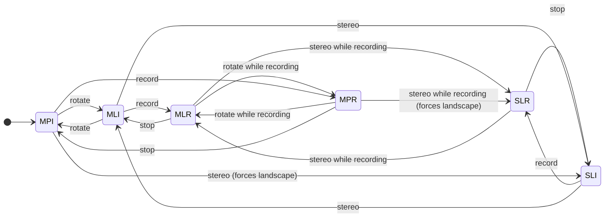

# EchoVision UI state machine

Three independent-looking axes — orientation, render mode, recording — give 2x2x2 = 8
combinations, but only **6 are reachable**. The constraints below are observed on device, not
assumed.

## Axes

| Axis | Values | Owner |
|---|---|---|
| Orientation | `Portrait`, `LandscapeLeft` | iOS autorotation, gated by `HoloKitCameraManager.m_SupportedMonoScreenOrientations` |
| Render mode | `Mono`, `Stereo` | `HoloKitCameraManager.ScreenRenderMode`, driven by the Stereo button |
| Recording | `Idle`, `Recording` | `HoloKitVideoRecorder.IsRecording`, driven by the record button |

## Constraints that shrink the space

1. **Stereo forces landscape.** `HoloKitCameraManager`'s Stereo branch pins the orientation;
   the Mono branch restores `ScreenOrientation.AutoRotation` and re-enables only the
   orientations in `m_SupportedMonoScreenOrientations`. Observed: `t=8.0 STEREO_ON
   orientation=Portrait` then `t=9.8 orient=LandscapeLeft mode=Stereo`.
   So **`Stereo + Portrait` is unreachable** — that removes 2 of the 8.
2. **Only Portrait and LandscapeLeft are allowed in Mono.** The scene sets
   `m_SupportedMonoScreenOrientations = Portrait | LandscapeLeft`, so `PortraitUpsideDown` and
   `LandscapeRight` never occur in this app.
3. **Stereo does not draw the camera background.** The Stereo branch disables
   `ARCameraBackground`, so orientation of the background is meaningless there.

## The 6 reachable states

| id | Orientation | Mode | Recording |
|---|---|---|---|
| `MPI` | Portrait | Mono | Idle |
| `MPR` | Portrait | Mono | Recording |
| `MLI` | Landscape | Mono | Idle |
| `MLR` | Landscape | Mono | Recording |
| `SLI` | Landscape | Stereo | Idle |
| `SLR` | Landscape | Stereo | Recording |

## Transition graph



## Transition table and status

`rotate` is the device turning; `record` is the record button; `stereo` is the Stereo button.

| # | From | Event | To | Status |
|---|---|---|---|---|
| 1 | MPI | rotate | MLI | **pass** — background and AR overlay upright and registered |
| 2 | MLI | rotate | MPI | **pass** — was 90 degrees off until the single-basis fix |
| 3 | MPI | record | MPR | **pass** — 415 frames, 0 dropped, 34 MB |
| 4 | MPR | stop | MPI | **pass** |
| 5 | MLI | record | MLR | **pass** — 342 frames, 0 dropped, 30 MB |
| 6 | MLR | stop | MLI | **pass** |
| 7 | MPI/MLI | stereo | SLI | **pass** — orientation pinned to landscape |
| 8 | SLI | stereo | MLI | **pass** — returns to Mono, autorotation restored |
| 9 | SLI | record | SLR | **FAIL** — writer dies, zero-byte file (see below) |
| 10 | SLR | stop | SLI | **pass** (state transition; the file itself is empty per 9) |
| 11 | MPR | rotate | MLR | **pass** — 1045 frames, 0 dropped across two rotations |
| 12 | MLR | rotate | MPR | **pass** — same recording survived both turns |
| 13 | MLR | stereo | SLR | **pass** — mode switched mid-recording without killing the writer |
| 14 | SLR | stereo | MLR | **pass** |

Transitions 11-14 were the suspicious ones: they change the render target's aspect or the
camera set *while* `AVAssetWriter` is locked to the width and height fixed at `StartRecording`.
They all pass. A recording begun in portrait and rotated to landscape and back kept going:
**1045 frames, 0 dropped**. The output stays at the resolution recording began with, which is
the correct and only option without re-creating the writer.

## Known failure: transition 9, recording in stereo

`SLI --record--> SLR` produces a **zero-byte file**. The audio input fails first and poisons the
whole writer:

```
Recording started: 2544x1168, writer status: 1
appendSampleBuffer error. Writer status: 3,
  AVFoundationErrorDomain Code=-11800, NSOSStatusErrorDomain Code=-16364
[VideoRecorder] appendPixelBuffer failed. status=3
Slot 2 submit returned -1        (x352)
GPU frames submitted=5 dropped=352
```

Writer status 3 is `AVAssetWriterStatusFailed`. The first audio append fails ~125 ms after the
writer starts, and from then on every video append fails too, which is why the dropped count is
large — the video path is a victim, not the cause.

**Not** caused by the 4K override: the retest with `RecordIn4K` skipped in stereo fails
identically. Root cause still open. A related observation from the same run is that
`AudioProcessor.AudioVolume` reads `0.0000` for the whole stereo phase, so the audio graph is
already behaving differently in stereo before recording is even attempted — the recorder takes
its `AudioListener` from its own GameObject, and the Stereo branch disables the mono camera.

## Coverage the automated walker needs

A full pass must cover all 14 transitions, and in each *state* assert:

- the render is upright and the AR overlay is registered with the background (Mono only —
  meaningless in Stereo, which draws no background),
- sound above `SoundWaveEmitter.emitVolumeThreshold` (0.02) emits a wave,
- for recording states: frames submitted > 0, dropped == 0, and the resulting file is non-empty
  with both a video and an audio track.
